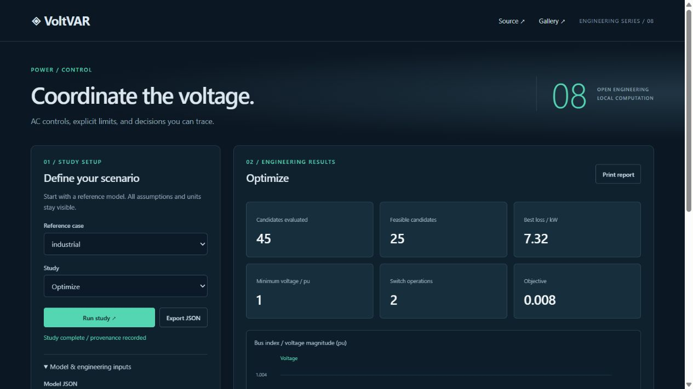

# VoltVAR

Voltage control and reactive power coordination using a pinned, standalone AC load-flow core.



## Run

```powershell
python -m pip install -e .
voltvar serve --port 8772
voltvar study example:industrial
python -m unittest discover -q
```

Open http://127.0.0.1:8772. The service binds only to loopback; no frontend build or cloud execution is required. Python 3.11–3.13. Export complete JSON with original inputs, options and SHA-256 fingerprint, or print the current report.

## Engineering capabilities

AC load-flow integration; transformer tap decisions; voltage-dependent switched shunts; inverter capability circles and piecewise Volt-VAR control; voltage, PF and thermal constraints; loss/voltage/switching objectives; bounded exhaustive discrete optimization; local regulator deadbands with cycle detection; chronological load/solar profiles; fixed-command solar stress scenarios.

## Scope and limits

Balanced positive-sequence steady state. GridFlow core is pinned and vendored under MIT. The coordinated optimizer is globally optimal only on its stated finite tap/capacitor/Q grid, with a candidate-count limit. It is not continuous AC OPF. Local controls are simultaneous bounded heuristics and can cycle; cycles and iteration limits are explicitly marked unsuccessful. Chronological optimization is myopic, with switching penalties against the previous accepted state. Inverter devices attach to PQ buses only. Capacitors are physical shunts whose MVAr varies with V². Fixed-command solar stress tests are not robust optimization. Source/slack Q limits, installation approval and switching transients require separate study.

## Validation

**231 passing tests**, including **200 complete analytical/reference cases** across twenty engineering families. Every case combines an input fixture, independent expected values, engineering derivation and executable regression in one reviewable commit. Further tests cover HTTP, CLI, boundary handling and input immutability. All three AC methods also match the external PYPOWER nine-bus reference. GitHub CI tests Python 3.11, 3.12 and 3.13 on Ubuntu. Passing tests establish the documented software checks, not installation certification.

Read [engineering conventions](docs/engineering.md), [API and interchange](docs/api.md), [validation](docs/validation.md), and [the ten-project gallery](https://victorodoyo.github.io/power-systems-gallery/). MIT license.
